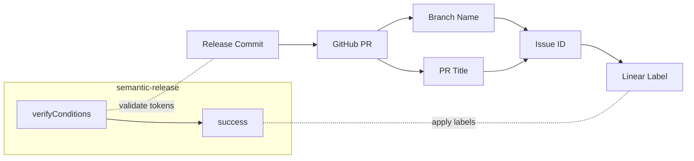

# semantic-release-linear-app

A [semantic-release](https://github.com/semantic-release/semantic-release) plugin that adds version labels to Linear issues based on the branch names and titles of associated Pull Requests.

## Install

```bash
npm install --save-dev semantic-release-linear-app
```

## Setup

1. Add to your `.releaserc.json`:

```json
{
  "plugins": [
    "@semantic-release/commit-analyzer",
    "@semantic-release/release-notes-generator",
    ["semantic-release-linear-app", {
      "teamKeys": ["ENG", "FEAT"]
    }],
    "@semantic-release/github"
  ]
}
```

2. Set environment variables:
   - `LINEAR_TOKEN` - Linear API key or OAuth token
   - `GITHUB_TOKEN` - For finding PRs (usually already set in CI)

3. Use branch names or PR titles with Linear issue IDs:

```
feature/ENG-123-add-auth
bugfix/FEAT-456-fix-bug
ENG-789
```

PR titles are also scanned, so issue IDs are picked up from titles like:

```
ENG-123: add auth
fix: resolve crash [FEAT-456]
fix(ENG-123, ENG-124): resolve issue
```

## Options

| Option | Default | Description |
|--------|---------|-------------|
| `teamKeys` | `[]` | Team keys to filter (e.g., `["ENG"]`) |
| `labelPrefix` | `"v"` | Prefix for version labels |
| `packageName` | `null` | Package name for monorepos (e.g., `"superdoc"` creates `superdoc-v1.0.0`) |
| `removeOldLabels` | `true` | Remove previous version labels |
| `addComment` | `false` | Add release comment to issues |
| `commentTemplate` | See below | Custom comment template with placeholders |
| `dryRun` | `false` | Preview without making changes |

### Monorepo Support

For monorepos with multiple packages, use the `packageName` option to create package-specific labels:

```json
{
  "plugins": [
    ["semantic-release-linear-app", {
      "teamKeys": ["SD"],
      "packageName": "superdoc"
    }]
  ]
}
```

This creates labels like `superdoc-v1.2.3` instead of just `v1.2.3`.

### Comment Templates

When `addComment` is enabled, you can customize the comment format using `commentTemplate`:

```json
{
  "plugins": [
    ["semantic-release-linear-app", {
      "teamKeys": ["SD"],
      "packageName": "cli",
      "addComment": true,
      "commentTemplate": "Released in {package} {releaseLink} {channel}"
    }]
  ]
}
```

**Available placeholders:**

| Placeholder | Example | Description |
|-------------|---------|-------------|
| `{version}` | `1.0.0` | Version number |
| `{channel}` | `(next channel)` | Release channel (empty for stable) |
| `{package}` | `**cli**` | Bold package name |
| `{packageName}` | `cli` | Raw package name |
| `{releaseUrl}` | `https://github.com/.../releases/tag/cli-v1.0.0` | GitHub release URL |
| `{releaseLink}` | `[1.0.0](https://...)` | Markdown link to release |
| `{gitTag}` | `cli-v1.0.0` | Git tag |

> **Note:** Placeholders are raw values. Add spaces in your template as needed—multiple spaces are automatically collapsed.

**Default template:** `Released in {package} v{releaseLink} {channel}`

**Example output:** `Released in **cli** v[1.0.0](https://github.com/org/repo/releases/tag/cli-v1.0.0) (next channel)`

## How it Works



1. **verifyConditions** - Validates `LINEAR_TOKEN` and tests API connection
2. **success** - After release:
   - Queries GitHub for PRs associated with release commits
   - Extracts issue IDs from PR branch names and PR titles (e.g., `ENG-123`), then merges them
   - Creates and applies version label to each issue

## Labels

Labels are color-coded by release type:

| Type | Color | Example |
|------|-------|---------|
| Major | Red | `v2.0.0` |
| Minor | Orange | `v1.1.0` |
| Patch | Green | `v1.0.1` |
| Prerelease | Purple | `v1.0.0-beta.1` |

## Authentication

Set `LINEAR_TOKEN` with either:
- **Personal API key** (starts with `lin_api_`) - used directly
- **OAuth access token** - automatically adds `Bearer` prefix

For OAuth setup, see [Linear OAuth documentation](https://linear.app/developers/oauth-2-0-authentication).

## License

MIT
